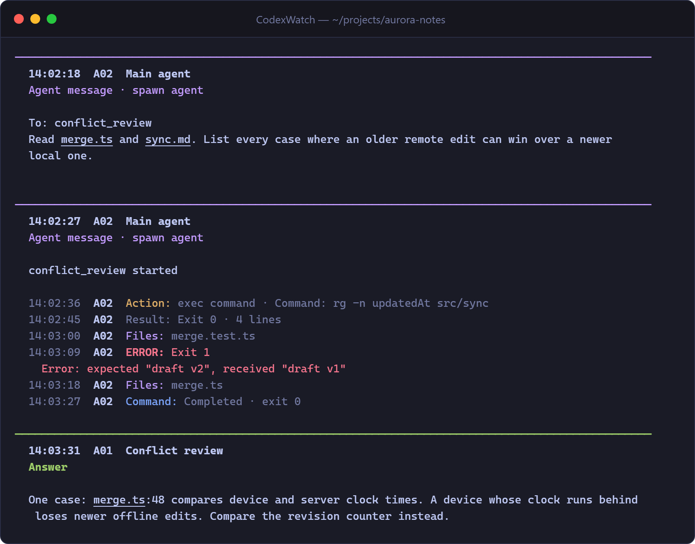
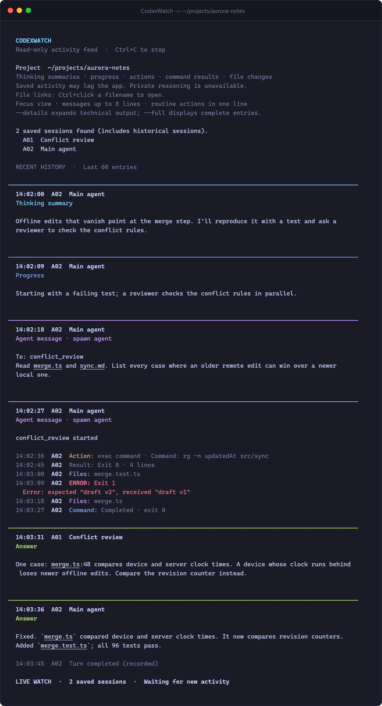

# CodexWatch

[](https://github.com/m4d3/CodexWatch/actions/workflows/ci.yml)

A lightweight, read-only terminal viewer for local Codex activity. Choose a project
folder and follow its main sessions and subagents without resuming or controlling them.
For Claude Code, see the companion viewer [ClaudeWatch](https://github.com/m4d3/ClaudeWatch).

<p align="center">
  
</p>
<p align="center"><sub>Made-up example session. Conversation gets cards; routine tool calls take one line.</sub></p>

## Quick start

Requires Python 3.11 or newer. No runtime packages, API keys, or account connection.

```sh
python codexwatch.py
python codexwatch.py /path/to/project
```

On Windows, double-click `codexwatch.bat` for the folder menu. Both Windows launchers
open Windows Terminal automatically for colors and clickable local file links,
or reuse it if you are already inside it. Administrator mode is not required.
If Windows Terminal is unavailable, the viewer falls back to copyable file paths.
You can paste a folder path if the optional Tk folder picker is unavailable.

```powershell
.\codexwatch.bat "C:\path\to\project"
```

## A feed designed for people

Colors identify activity at a glance: blue progress, cyan reasoning summaries, purple coordination and files, yellow actions, green answers, and red errors. Routine results stay muted. The Windows launchers explicitly enable colors, including when `NO_COLOR` is inherited from another app. Use `--plain` or `--color off` to disable them. Direct Python launches respect `NO_COLOR` unless passed `--color on`.

The default focus view emphasizes saved reasoning summaries, progress, answers,
plans, and coordination between agents. Routine actions and results take one line.
Failed commands and clear error diagnostics get a red ERROR marker. Warnings and approval blocks get an amber ATTENTION marker. Successful zero-error reports stay routine. Internal approval reviews
that simply allow an action are quiet. Rejected reviews remain visible.

<details>
<summary><b>Full example:</b> startup banner, thinking summary, progress, subagent hand-off, and final answer</summary>
<br>
<p align="center">
  
</p>
</details>

The screenshots show a made-up project and session. No real user logs are distributed.

| Option | Purpose |
| --- | --- |
| `--details` | Expanded technical cards, commands, and file references |
| `--full` | Complete text of records within the record-size limit |
| `--raw` | Technical JSON display and full session identifiers |
| `--max-lines 60` | Longer human message previews in focus view |
| `--history 0` | Start with new activity only |
| `--history 100` | Request more startup entries, within the history budget |
| `--plain` | No colors or hyperlink escape sequences |
| `--links auto/on/off` | Terminal hyperlink preference |
| `--log-root /path/to/sessions` | Use an alternate local rollout directory |

Stop with **Ctrl+C**. This stops only CodexWatch, not your agents.

## File links

Existing local files referenced in messages can be opened with Ctrl+click in Windows
Terminal. Other terminals may use a different gesture. Images use the default image
application; documents use the associated application. Files are never opened
automatically. Plain terminals show copyable paths. Links do not navigate to source
line numbers. Relative references use the agent's starting directory.

Launching in an older Command Prompt or PowerShell console does not add hyperlink
support, even as administrator. Install Windows Terminal to use clickable links.
For scripts or an intentional launch in the current console, set
`CODEXWATCH_CURRENT_CONSOLE=1` before running the batch launcher. `--links on`
only emits link sequences; the terminal still needs to support them.

Existing filenames are linked directly in readable text; repeated standalone links
are removed. Artifacts outside a shortened preview still get a link. Routine entries
show image references without duplicating an additional file list. Missing filenames
remain plain text because there is no valid file to open. Network/UNC targets are
excluded. Detection is limited to 2,048 candidates and 128 existing files per record.
Ambiguous bare filenames cannot safely identify a target; use a relative/full path.
The raw JSON mode keeps its original text and supplemental references.

## Privacy and safety

CodexWatch has no telemetry, network client, credentials access, or model calls.
It reads local rollout files and checks local referenced paths. The only subprocess
is a fixed, read-only `git worktree list` invocation using an argument list; log text
is never executed or passed to a shell. Git is located only through absolute `PATH`
entries (never the current folder), Git's repository ownership checks stay active, and
`core.fsmonitor` is disabled so repository configuration cannot start a program.
Git is optional. A missing Git command does not prevent watching the selected folder.

Exact repeated events are suppressed using a bounded cache. Focus view also omits
a successful result envelope when a command result already reports the same exit
codes in that second. Later updates and errors remain visible; this is not a claim
that all semantically equivalent prose can be detected.

The viewer ignores system/developer instructions, private/raw reasoning, and encrypted
content. Recorded terminal escape sequences are stripped. Hyperlinks are generated
from validated existing local paths, not copied from log escape sequences.
Timestamp headers are sanitized too. Malformed JSON, invalid display fields, and
unpaired Unicode surrogates are skipped with a notice so later records can still
be displayed. Missing or null timestamps display without a time label.

**Displayed agent messages, tool output, and paths can still contain private project
information.** Review terminal captures before sharing them. This is a viewer, not a
redaction tool. Clicking a file uses your OS associations, including executable file
types. Do not click unfamiliar executable references.

## Resource handling and limitations

Records are streamed one at a time. The session index and agent label cache retain
at most 4,096 recent sessions; tool-call tracking retains at most 256 entries. Duplicate-event hashes retain at
most 512 entries; command-result deduplication retains at most 256. Startup
history has a count limit and a 2-million-character text budget, with a 16,384-character
preview per entry, and is released after display. Metadata retains only display and
matching fields, not prompts or account identifiers.

Individual records over 8 MiB are skipped with a notice during live watching. This
also applies to `--full`; inspect the source log for oversized data. Incomplete lines
are retried, and oversized incomplete lines are discarded in bounded chunks.
Formatting may temporarily allocate additional copies of one record. These limits
are safeguards, not a guarantee of an exact process RAM limit.

Logs are polled every second, new sessions every four seconds, Git worktrees at most
once per minute. Terminal scrollback is managed by your terminal. CodexWatch writes
no activity logs. Python may create its normal bytecode cache when imported.

The viewer follows the selected working directory, its descendants, registered Git
worktrees, and linked child sessions. Agents created elsewhere that merely edit the
project are not automatically associated. Old sessions are included; a saved file
does not prove an agent is running. The 4,096-session limit may exclude older parent
relationships. Live events preserve order within each session; different sessions
are read in polling order rather than a strict global timestamp order.

Saved activity can lag the app. Ephemeral sessions, cloud sessions without local logs,
binary attachments without saved paths, and unsaved in-flight activity are unavailable.
Only model-emitted reasoning summaries are shown. Error detection is heuristic and
can flag words quoted in output; use details to assess the actual result.

Codex rollout JSONL is an internal format and may change. Compatibility is based on
observed `session_meta`, `response_item`, and `event_msg` records, not a stable API.

## Development

```sh
python -m unittest discover -s tests -v
python -m ruff check .
python -m ruff format --check .
```

Install Ruff only for development (`python -m pip install ruff`). Functional tests
use synthetic logs and temporary files, without contacting OpenAI. CI runs on
Windows, Linux, and macOS with Python 3.11 and 3.13. No performance benchmarks are included.

See [CONTRIBUTING.md](CONTRIBUTING.md) and [SECURITY.md](SECURITY.md).

## License

[MIT](LICENSE). Independent community utility; not an official OpenAI product.
